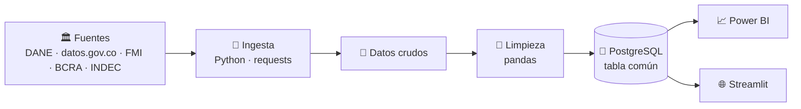
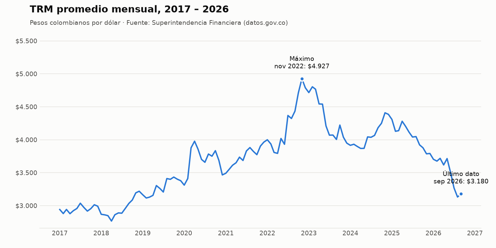
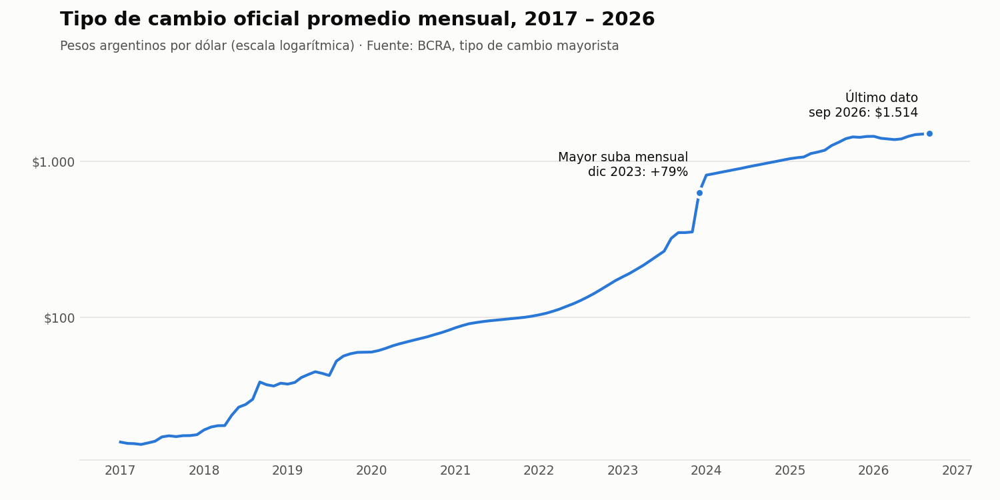

<p align="center">
  
  
  
</p>

<p align="center">
  
  
  
  
  
</p>

Proyecto en equipo que compara la inflación, el tipo de cambio, las tasas de interés y la política monetaria de **Colombia** y **Argentina** con datos oficiales: un pipeline en Python que descarga y limpia las series, una base común en PostgreSQL y dashboards en Power BI y Streamlit.

## 🎯 El problema en una línea

| 🇨🇴 Colombia | 🇦🇷 Argentina |
| --- | --- |
| Metas de inflación | Historial de alta inflación |
| Tipo de cambio flotante | Restricciones cambiarias y brecha con el dólar paralelo |

La pregunta: **¿cómo se comportan la inflación, el tipo de cambio y las tasas de interés en dos economías con regímenes tan distintos, y qué relaciones se pueden medir entre ellas?**

| | |
| --- | --- |
| 📅 **Periodo** | enero de 2017 a la fecha, frecuencia mensual |
| 📊 **Indicadores** | Inflación, tipo de cambio, tasas de interés, reservas internacionales y agregado monetario |
| 🏛️ **Fuentes** | DANE · datos.gov.co · FMI · BCRA · INDEC · datos.gob.ar |
| 🛠️ **Herramientas** | Python · pandas · PostgreSQL · SQL · Power BI · Streamlit |

## 🔄 Cómo fluyen los datos



## 🗺️ Cuatro fases, una por semana

| Fase | Qué se hace | Herramienta | Resultado | Estado |
| --- | --- | --- | --- | :---: |
| **1. Ingesta** | Descargar las series de las fuentes oficiales | Python · requests | Datos crudos de ambos países | 🔄 |
| **2. Limpieza y base de datos** | Llevar las series a un esquema común, controlar su calidad y cargarlas | pandas · PostgreSQL | Una tabla única y confiable | ⏳ |
| **3. Análisis** | Comparar inflación, tipo de cambio y tasas reales entre los dos países | SQL · pandas | Entre 4 y 6 hallazgos con su gráfico | ⏳ |
| **4. Dashboards** | Presentar los resultados de forma interactiva | Power BI · Streamlit | Dos dashboards y un informe | ⏳ |

✅ Terminada · 🔄 En curso · ⏳ Pendiente

## 📊 Indicadores

| Indicador | 🇨🇴 Colombia | 🇦🇷 Argentina |
| --- | --- | --- |
| 📈 Inflación (IPC) | DANE ✅ | INDEC ✅|
| 💱 Tipo de cambio oficial | TRM (datos.gov.co) ✅ | BCRA ✅ |
| 💵 Tipo de cambio paralelo | No aplica | A definir |
| 🏦 Tasa del mercado monetario | FMI ✅ | FMI ✅ |
| 🪙 Reservas internacionales | FMI ✅ | FMI ✅ |
| 💰 Dinero amplio | FMI ✅ | FMI ✅ |

✅ Serie descargada, limpia y cargada en PostgreSQL.

> 🌐 **Por qué el FMI:** el Banco de la República no tiene una API abierta para estas tres series. El FMI recibe los datos de cada banco central y los publica con **las mismas definiciones para todos los países**, lo que hace la comparación más justa.

Las decisiones detrás de cada elección están en [`docs/decisiones.md`](docs/decisiones.md).

## 📈 Primer vistazo

La primera serie que recorrió el pipeline completo (descarga → limpieza → PostgreSQL → gráfico):

<p align="center">
  
</p>
<p align="center">
  
</p>
## 🔍 Hallazgos

> Se completarán en la fase 3.

## ▶️ Cómo ejecutarlo

```bash
git clone https://github.com/SimonBedoyaMontiel/observatorio-macro-colombia-argentina.git
cd observatorio-macro-colombia-argentina
pip install -r requirements.txt
```

Después:

1. Crear en PostgreSQL una base llamada `observatorio` y ejecutar [`sql/crear_tablas.sql`](sql/crear_tablas.sql).
2. Copiar `.env.example` como `.env` y completar los datos de conexión.
3. Ejecutar el pipeline:

```bash
python ingesta/colombia/descargar_trm.py   # 1. descarga
python ingesta/colombia/descargar_ipc.py
python ingesta/colombia/descargar_fmi.py
python ingesta/argentina/descargar_tipo_cambio.py
python ingesta/argentina/descargar_ipc.py
python ingesta/argentina/descargar_fmi.py
python limpieza/colombia/limpiar_trm.py    # 2. limpieza
python limpieza/colombia/limpiar_ipc.py
python limpieza/colombia/limpiar_fmi.py
python limpieza/argentina/limpiar_tipo_cambio.py
python limpieza/argentina/limpiar_ipc.py
python limpieza/argentina/limpiar_fmi.py
python carga/cargar_datos.py               # 3. carga a PostgreSQL
python analisis/grafico_trm.py             # 4. gráfico
```

## 📂 Estructura del repositorio

```
├── ingesta/
│   ├── colombia/            # Scripts de descarga de Colombia
│   └── argentina/           # Scripts de descarga de Argentina
├── limpieza/
│   ├── colombia/            # Scripts que llevan cada serie al esquema común
│   └── argentina/           
├── carga/
│   └── cargar_datos.py      # Carga los datos limpios a PostgreSQL
├── datos/
│   ├── crudos/              # Datos tal como vienen de la fuente
│   └── limpios/             # Datos en el esquema común
├── sql/
│   └── crear_tablas.sql     # Creación de la tabla de observaciones
├── analisis/
│   ├── grafico_trm.py       # Gráfico de la TRM desde PostgreSQL
│   └── graficos/            # Imágenes de los gráficos
├── dashboard/               # Dashboards en Power BI y Streamlit
├── docs/
│   └── decisiones.md        # Decisiones del proyecto y su motivo
├── .env.example             # Modelo de configuración de la base de datos
└── requirements.txt
```

## 👥 Equipo

| | País | Rol |
| --- | :---: | --- |
| **Simón Bedoya Montiel** | 🇨🇴 | Datos de Colombia · Dashboard en Power BI |
| **[Gonzalo Ducca](https://github.com/gonducca)** | 🇦🇷 | Datos de Argentina · Dashboard en Streamlit |

<p align="center">
  <a href="https://www.linkedin.com/in/simon-bedoya-montiel/">
    
  </a>
  <a href="https://www.linkedin.com/in/gonzalo-ducca-b079011b2/">
    
  </a>
</p>
